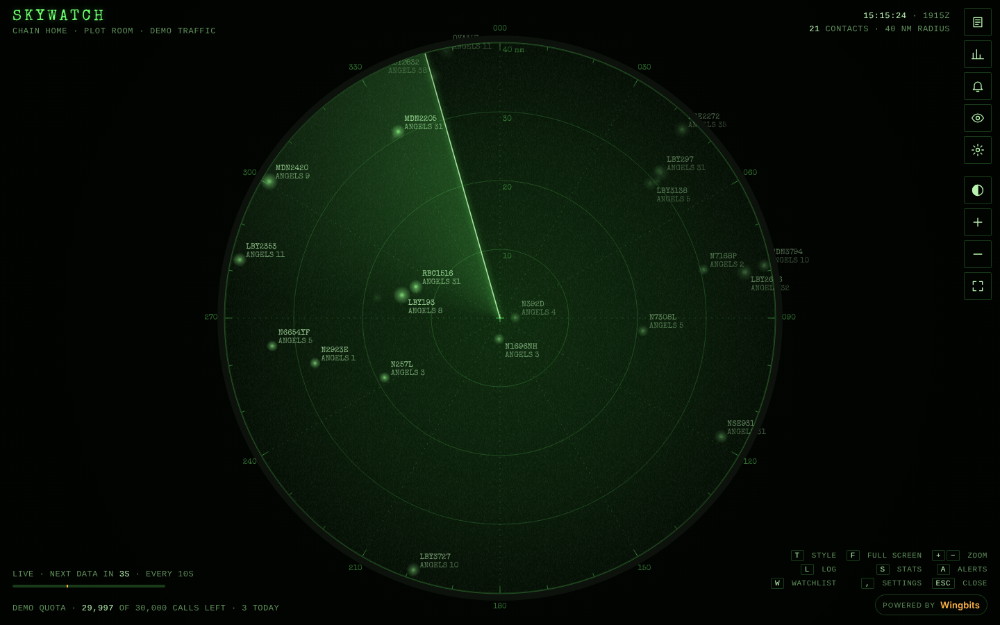
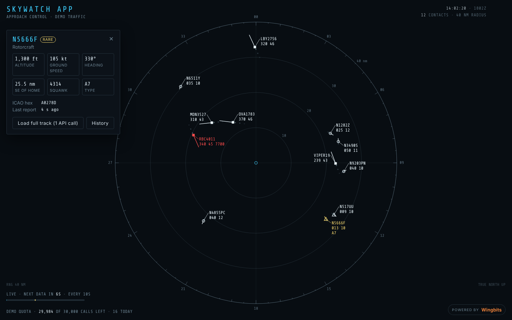
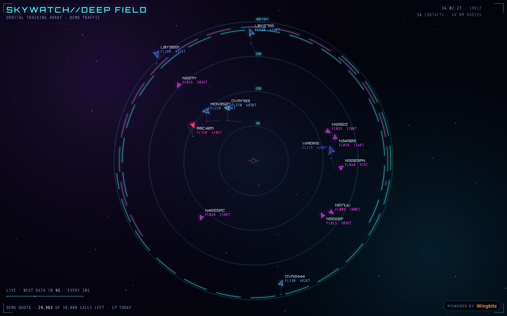
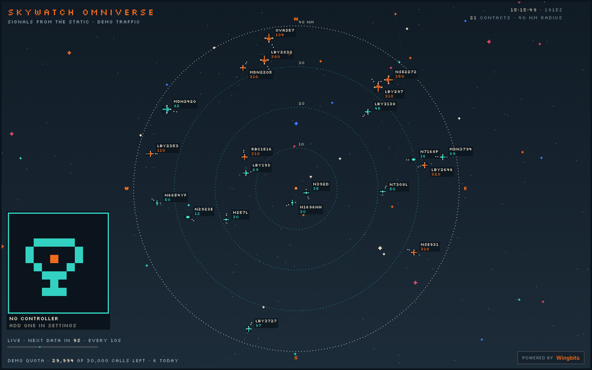

# Skywatch Radar

A live radar screen for the aircraft around your home, for [Umbrel](https://umbrel.com).
Data comes from the [Wingbits](https://wingbits.com) ADS-B network through its Customer API.

Put it full screen on a spare monitor and leave it running.

| WW2 plot room | Control tower |
|---|---|
|  |  |
| **Deep field** | **Omniverse** |
|  |  |

## What it does

- **Four view styles.** A WW2 phosphor scope with a rotating sweep, a modern
  approach-control screen with data blocks and leader lines, a holographic deep-field
  display with altitude stalks, and a pixel-art Omniverse. Each screen remembers its own style.
- **Smooth on a small budget.** Between polls, every contact keeps moving along its
  reported speed, heading and bank angle, and corrections blend in when fresh data arrives.
  In the WW2 view contacts only refresh as the beam passes them, like a real scope.
- **Paces itself against your plan.** Skywatch reads your plan and remaining quota from
  `/v1/account/usage` (a free call) and spreads the rest evenly until the monthly reset.
  It polls faster while a screen is open, slows down or pauses when nobody is watching,
  and can slow down during quiet hours. Give it a percentage of the quota if the same key
  powers other projects. Rate limits (429) back off automatically.
- **Spotter log and life list.** Every aircraft and type you have seen, with first and last
  sightings, visits, closest pass and altitudes. Exports to CSV.
- **Stats and heatmap.** Traffic per hour and per day, busiest times, top types and operators,
  and a heatmap of where aircraft fly over you.
- **Watchlist.** Track aircraft by callsign, registration or ICAO hex. Matches inside your
  radar circle are free; optional searches beyond it use a small daily cap.
- **Alerts with ntfy.** Emergency squawks (7500/7600/7700), watchlist sightings, military
  traffic, new types, low aircraft, helicopters and more, pushed to your phone through
  [ntfy](https://ntfy.sh) if you like. Alerts are worked out from data the radar already has.
- **GPS interference overlay.** Optional, one API call a day, from `/v1/gps/jam`.
- **Wingnauts.** Enter the public Solana wallet that holds your Wingnauts and one becomes
  your radar operator in the Omniverse view (and drops by elsewhere now and then).
  Read-only: nothing is signed. Its size is adjustable from Small to XL.
  Optional sound effects (off by default, per screen, Omniverse view only): radio calls, mic clicks, the spaceship, new-contact pings and a Big Bang.
  Try the Konami code, and if you know how pilot-controlled runway lights work, try that on the controller.

## Install

1. In your Umbrel, open the **App Store**, click the **⋯** menu at the top right and choose
   **Community App Stores**.
2. Paste `https://github.com/PatriotCrypto/umbrel-skywatch` and click **Add**.
3. Open the **Skywatch** store and install **Skywatch Radar**.

## Set up

Skywatch starts on simulated demo traffic so you can try it straight away.

1. **API key.** Create a key on the [Wingbits API dashboard](https://wingbits.com/dashboard/developers)
   and paste it into **Settings → Wingbits API**. Wingbits station operators get a free
   Starter plan. The key is stored only on your Umbrel and never sent back to the browser.
2. **Home location.** Enter your latitude and longitude (right-click your house in Google Maps
   to copy them) and the radius to watch. One poll costs one call whatever the radius.
3. **Budget.** Balanced is a good start. The settings page shows how often the radar will
   refresh before you save.

### How the budget works

On a 30,000-call month with a screen open about half the time, Balanced refreshes about
once a minute while you watch and every six or seven minutes in the background, and
still finishes the month with calls to spare. Aircraft details are
fetched in batches of up to 100 and cached forever, so after the first few days they cost
almost nothing. About 8% of the allowance is kept in reserve for details, tracks and the
GPS overlay.

## Privacy

- Everything Skywatch logs stays in the app's data folder on your Umbrel.
- Aircraft enrolled in the FAA LADD or PIA privacy programs are shown and stored without
  registration, owner or operator.
- No analytics, no telemetry. The only outside services contacted are the Wingbits API,
  your ntfy server if you set one, and your Solana RPC if you use the Wingnauts feature.

## Development

```bash
cd app
npm install
npm start          # http://localhost:3928, demo traffic until a key is set
npm test           # budget maths, Wingnauts lookup, and an end-to-end run against a mock Wingbits API
```

Environment variables: `PORT` (3928), `DATA_DIR` (`app/data`), `WINGBITS_API_BASE`.

### Publishing a new version

1. Bump `version` in `app/package.json` and `skywatch-radar/umbrel-app.yml`, and the image tag in
   `skywatch-radar/docker-compose.yml`.
2. Push a tag such as `v0.1.1`. The **Publish image** workflow builds for amd64 and arm64 and
   pushes `ghcr.io/patriotcrypto/skywatch-radar`.
3. Pin the image digest from the workflow summary in `docker-compose.yml`.

## Credits

Aircraft data powered by [Wingbits](https://wingbits.com). Skywatch is an unofficial community
app and is not made, endorsed or supported by Wingbits. Wingnauts artwork belongs to its
creators; Skywatch only displays NFTs held by the wallet you enter.

Fonts: Special Elite (Apache 2.0), Share Tech Mono, Orbitron and Silkscreen (SIL OFL 1.1).

MIT licensed.
